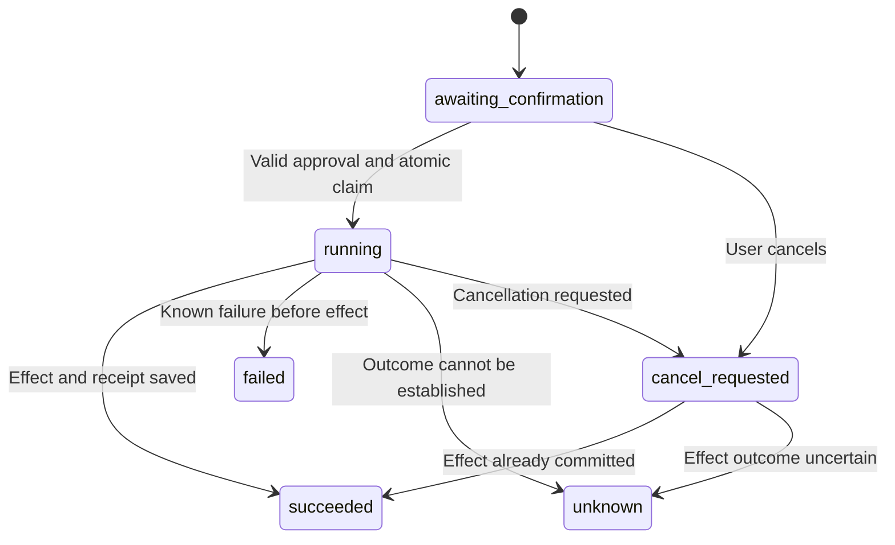

# Panthorium Browser / Google Cloud foundation

Implementation date: 2026-10-15. Base: staging `cc824dc`.

## Product boundary

Panthorium Browser is the only product client. It captures microphone input,
plays output, renders windows and obtains user approval. AI execution, persistent
memory, jobs, app runs and files remain on the existing Google Cloud deployment.
This change does not add local AI, offline task execution, independent profession
apps, desktop icons, or changes to the desktop/orb/window theme.

The Start Menu receives four groups: life/age, learning, work and specialist
professions. All new app windows use the existing window manager and theme.

## Implemented behavior

| Component | Behavior | Boundary |
|---|---|---|
| App catalog | 31 packs, 186 selectable workflows with detailed task instructions | This count is workflow coverage, not 186 live external integrations |
| App runtime | Authenticated Cloud sessions, bounded assisted drafting from user input/manual source excerpts, persistent results, cancellation, history and JSON export | No external sending, browsing, purchases, medical decisions or device actions |
| Scopes | `personal`, `work`, `study`, `family`, owner-scoped memory and app history | All four are private contexts; family/work do not imply shared access |
| Memory | Confirmation status, provenance, sensitivity, expiry and immutable scope | Metadata is PostgreSQL; note content remains in GCS; unscoped knowledge is excluded outside personal |
| Action ledger | Immutable proposal, argument hash, expiring approval, stable idempotency key and durable execution receipt | Uncertain external outcomes require reconciliation; no claim of universal exactly-once effects |
| Voice | Versioned conversation events, bounded queues, stop/backpressure, truthful cancellation and Cloud lease ownership | Private voice approval and provider resumption are gated experiments |
| Scheduled work | Authenticated OIDC tick, durable jobs, atomic recurrence materialization, reminder snooze/recurrence | Existing verified-email delivery channel; no simulated push notification |
| Privacy | In-app AI output reports and durable account-deletion request queue; direct `/account-deletion` web route | Actual erasure requires the documented manual processing workflow; requesting is not erasing |
| Usage | Typed provider usage metadata and terminal outcome events without prompts/transcripts | Raw snapshots are not a currency invoice and must not be blindly summed |
| Entitlements | AI/files quotas apply even when checkout is in test mode; download quota checked before GCS media fetch | Checkout and quota enforcement are independent |

An app run remains a **draft requiring review**. Dependency labels in the catalog
describe what a future full workflow needs, not an installed connector. Children’s
packs are unavailable unless both server flags and the actual provider/age policy
have been reviewed. Never infer a user's age or profession from their voice.

## Execution and approval

The Browser submits a stable request key once per user intent. The action ledger
binds it to the authenticated owner, tool and canonical argument hash. Conflicting
reuse is rejected. Approval uses the stored `actionId` and `approvalHash`; model
output such as `confirmed: true` is not approval. Workflow confirmations execute
the stored step and do not ask the model to regenerate it.

No retry endpoint resets an uncertain action to an executable state. Provider
idempotency support and connector-specific reconciliation remain necessary for
external side effects. Read-only operations keep their existing behavior.

## Browser/cloud contracts

All public endpoints require the existing Bearer authentication and account checks.
Cloud app APIs also require `chat`, JSON for writes, body limits and reject
cross-site browser writes. Responses containing user content are not cacheable.

| Route | Input / purpose |
|---|---|
| `GET /api/cloud-apps/catalog` | Catalog plus honest storage/AI/connector readiness |
| `POST /api/cloud-apps/sessions` | `{packId, scope}`; server-issued session valid for 10 minutes |
| `POST /api/cloud-apps/sessions/:id/execute` | `{featureId,input,sources:[{title,content}],idempotencyKey}` |
| `GET /api/cloud-apps/runs?scope=work` | Owner-scoped history; optional pack/idempotency filters |
| `GET /api/cloud-apps/runs/:id` | Actual persisted status |
| `POST /api/cloud-apps/runs/:id/cancel` | Request cancellation; completed output is not relabeled cancelled |
| `GET /api/cloud-apps/runs/:id/export` | Portable JSON draft with provenance and status |
| `GET /api/actions/:actionId` | Durable action receipt |
| `POST /api/actions/:actionId/confirm` | Exactly `{approvalHash}`; immutable stored arguments |
| `POST /api/actions/:actionId/cancel` | Truthful cancellation result |
| `POST /internal/jobs/tick` | Google-signed OIDC token with configured audience and allowlisted service-account email |

Memory routes remain under `/api/agent/memory`; scope defaults to `personal` for
backward compatibility. Scope is an owner-private partition, not an authority.

Application voice events use `type: conversationEvent`, `protocolVersion: 1`,
`sessionId`, `connectionId`, `turnId`, monotonic connection `sequence`, `event`
and `payload`. Existing provider audio frames remain compatible. These events
describe state and do not grant capabilities. `PanthoriumCloudApps.voiceContext()`
returns a server-issued app session plus selected feature/scope. The backend
revalidates ownership, expiry, pack and feature before adding context.

Cloud-app context sessions do not resume provider handles. A context change stops
the current voice session and requires a fresh one so previous scope context is
not carried into another scope. General voice resumption handles are encrypted
with identity-bound AES-GCM and never sent to the Browser.

## Model and resource limits

App generation uses the existing Gemini Live provider on Google Cloud. It does
not substitute an unapproved model. Default AUDIO responses are natural-language
drafts transcribed by the provider and wrapped by the server; there are no claimed
machine-verified citations. Verified TEXT mode uses strict JSON validation. A
configured provider is not proof that a live connection has passed a smoke test.

Per app request: 4,000 input characters, five source excerpts of up to 2,000
characters, 10,000 combined characters, 24,000 UTF-8 prompt bytes, requested 1,536
output tokens and 45-second deadline. Abort closes the provider connection,
including a connection that completes after the deadline. Each owner is limited
to one active app run, three runs per minute and thirty per rolling day, in
addition to existing paid/free entitlements. These initial ceilings are
deliberately conservative and are not subscription entitlements.

Provider usage events are cumulative/raw snapshots; terminal events may contain
no additional tokens. Analytics must understand each provider's snapshot
semantics and session identity before deriving usage deltas. No exchange rate,
Google invoice total or profit estimate is fabricated by this ledger.

## Production configuration and rollout

Use the existing Cloud SQL/GCS/Cloud Run project and runtime identity. Additive
schema initialization runs before listening. Production requires persistent
storage; there is no in-memory fallback for new durable jobs/actions/apps.

| Variable | Default / action |
|---|---|
| `DATABASE_URL`, `DATABASE_SSL_MODE` | Existing managed database; `disable` only for the existing secured proxy/socket connection |
| `PANTHORIUM_FILES_BUCKET` | Existing owner-prefixed GCS bucket |
| `VOICE_SESSION_ENCRYPTION_KEY` | Secret Manager key recommended; otherwise existing JWT secret derives the encryption key |
| `SCHEDULER_OIDC_AUDIENCE` | Required to activate external job ticks |
| `SCHEDULER_SERVICE_ACCOUNTS` | Comma-separated allowed Google service-account emails |
| `PANTHORIUM_SCHEDULER_INTERVAL_FALLBACK` | Production interval is disabled; `1` explicitly enables temporary fallback |
| `GEMINI_LIVE_RESUMPTION` | Off unless `1`; requires durable checkpoint store and real-provider validation |
| `GEMINI_LIVE_CONTEXT_COMPRESSION` | Off unless `1`; requires provider validation |
| `PANTHORIUM_VOICE_PRIVATE_APPROVAL` | Off unless `1`; narrow private note/memory creation only, pending real-provider validation |
| `GEMINI_LIVE_TEXT_OUTPUT_VERIFIED` | Off unless `1`; set only after exact model/project TEXT smoke test |
| `PANTHORIUM_CHILD_FEATURES_ENABLED` | Off unless `1` |
| `PANTHORIUM_CHILD_PROVIDER_POLICY_VERIFIED` | Off unless `1`; setting a flag does not replace the actual review |

`scripts/configure-cloud-scheduler.sh` prints the exact Scheduler command by
default; `--apply` creates the job in the selected existing Google project. It
does not deploy Cloud Run, alter ingress/IAM or create another cloud. Configure
the backend audience/allowlist and verify one authenticated tick before routing
production scheduled work to this revision. Without this, production background
ticks are intentionally inactive. A Scheduler attempt timeout is not proof that
an external effect failed; durable job/action state determines the next step.

Stage in this order: initialize additive tables; run CI and real PostgreSQL tests;
deploy the reviewed staging revision; test one adult account across two instances
for voice, cancel, approval, scopes, quotas and reminder delivery; validate model
and provider flags; review release gates; promote the same image. Do not enable
child/voice-approval/resumption features solely because mock tests pass.

Rollback can restore the prior container image because new tables are additive.
Do not delete the action ledger, reminder outbox or uncertain receipts during
rollback, and do not requeue uncertain actions. In-flight generation and provider
connections must be drained before switching all traffic. Changing the voice
encryption secret invalidates old checkpoints and forces a fresh session.

## Validation and outstanding release gates

`npm test` runs the existing regression suite plus `test:cloud-foundation`.
`npm run test:postgres` uses `TEST_DATABASE_URL` against a disposable real
PostgreSQL instance in CI; local execution explicitly skips when it is absent.
Mock/provider-emulator tests establish contracts, not real model quality,
production IAM, clinical/legal correctness, or device compatibility.

Still requires deployment evidence: real Google Cloud voice/structured output,
Scheduler OIDC/IAM and email delivery; cross-instance disconnect recovery;
production budget/latency measurements; request-queue operations, retention and complete account-erasure
workflow; Android signed release and Play policy review. Android release preparation now has a manual signed-AAB workflow, locked dependencies,
production-origin validation and release WebView debugging disabled; see
`mobile/android/README.md`. A real signed AAB and device smoke test are still pending.
No new occupational connectors, glasses drivers, background hotword OS privileges or Play publication
are claimed by this change.

## Extending to future devices

New glasses/headset adapters should consume the versioned conversation protocol
and server capability checks through Panthorium Browser. Keep sensor consent,
hardware capability negotiation and foreground/background lifecycle explicit.
Add a connector behind the same action ledger only after its exact scopes,
idempotency, receipts and compensation limits are defined. Preserve portable
user exports and versioned migrations so models, databases and device protocols
can be replaced. This is an extensible architecture, not a claim to predict
technology two hundred years in advance.

## Store-policy reference checked during implementation

Google Play requires an accessible account-deletion request pathway and related
web resource, plus in-app reporting for applicable AI-generated content. The new
request/report interfaces address those pathways; they do not establish that
actual deletion operations, all data disclosures or store review have passed.

- https://support.google.com/googleplay/android-developer/answer/13327111
- https://support.google.com/googleplay/android-developer/answer/13985936

The deletion request queue is available at `/api/privacy/account-deletion`;
AI reports at `/api/privacy/reports`. Authorized staff review the internal queue
at `/api/privacy/operator/requests`. Completion requires a separate manual
processing state and a written resolution. Staff must actually complete and
verify the account/data deletion before recording completion; this change does
not automatically erase GCS objects, provider data, backups or billing records.
