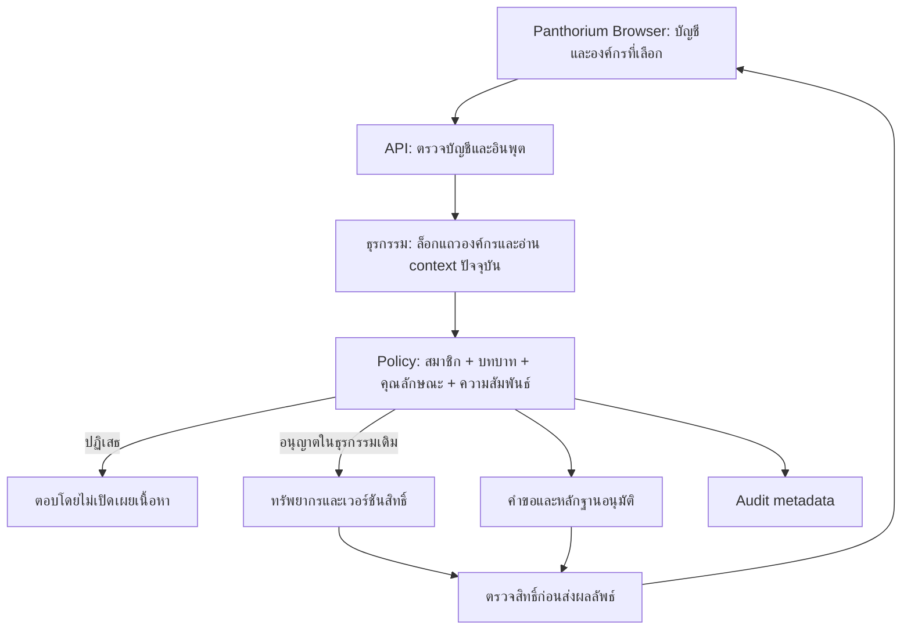

# สถาปัตยกรรมองค์กรใน Panthorium Browser

เอกสารออกแบบและขอบเขตการส่งมอบ วันที่ 15 ตุลาคม 2026 สำหรับการขยายระบบส่วนตัวเป็นระบบหลายองค์กรบน Panthorium Cloud เดิม การมีโค้ดและการทดสอบไม่ได้ยืนยันว่ารุ่นนี้ขึ้น production แล้ว หรือผ่านการรับรองความปลอดภัยสำหรับข้อมูลที่มีข้อกำหนดพิเศษ

## 1. ขอบเขตผลิตภัณฑ์และคำมั่นที่ตรวจสอบได้

ผู้ใช้ทำงานผ่าน **Panthorium Browser เดียว** หน้าต่างองค์กรเป็นส่วนหนึ่งของ Browser ไม่ใช่แอปอาชีพแยก และไม่ติดตั้ง agent ประมวลผล AI บนเครื่องผู้ใช้ Browser รับคำสั่ง แสดงข้อมูล รับการอนุมัติ จัดการไมโครโฟนและเสียง ส่วนการตัดสินสิทธิ์ แอป AI ความจำ ไฟล์ ประวัติ และงานเบื้องหลังอยู่ที่ Panthorium Cloud บน Google Cloud ที่ระบบใช้อยู่

บัญชีหนึ่งเป็นสมาชิกหลายองค์กรได้ แต่ทุกคำขอเลือกองค์กรเดียว ไม่มีคำสั่ง “ค้นทุกบริษัทที่ฉันเกี่ยวข้อง” โดยปริยาย พื้นที่ส่วนตัวเดิม `personal`, `work`, `study`, `family` เป็นการแบ่งข้อมูลของบัญชีเดียว แม้ชื่อ `work` ก็ไม่ใช่ข้อมูลบริษัท และ `family` ไม่ทำให้สมาชิกครอบครัวอ่านได้ การนำข้อมูลส่วนตัวไปองค์กรต้องเป็นการกระทำที่ผู้ใช้ตั้งใจ และต้องอยู่ภายใต้นโยบายองค์กร ไม่เปลี่ยนเจ้าของหรือแชร์ย้อนหลังเพียงเพราะเลือกหน้าต่างองค์กร

เป้าหมายคือระบบที่เปลี่ยนโมเดล ฐานข้อมูล และอุปกรณ์ได้โดยรักษาสิทธิ์และหลักฐาน ไม่ใช่รับประกันเทคโนโลยีล่วงหน้า 200 ปี เกณฑ์ความก้าวหน้าคือการย้ายเวอร์ชันได้ การส่งออกข้อมูลที่ได้รับอนุญาต การเพิกถอนสิทธิ์ที่ตรวจสอบได้ และการทดสอบพฤติกรรมเมื่อระบบบางส่วนล้มเหลว

## 2. รูปแบบองค์กรที่ควรรองรับ

ตารางนี้เป็นรูปแบบการใช้งานเพื่อเลือกโครงสร้างและแผนทดสอบ ไม่ใช่จำนวนสมาชิกที่รับประกัน หรือแพ็กเกจที่เปิดขายแล้ว

| รูปแบบ | โครงสร้างเริ่มต้น | งานแรกที่ให้คุณค่า | ขอบเขตที่ต้องตกลงก่อนขยาย |
|---|---|---|---|
| ผู้ประกอบการคนเดียว / ธุรกิจจิ๋ว | องค์กรหนึ่งแห่ง เจ้าของหนึ่งคน แยกบัญชีส่วนตัว | บันทึกงาน เอกสารมาตรฐาน ร่างงานที่ตรวจเอง | ผู้ช่วยภายนอกเห็นเฉพาะเอกสารที่แชร์ ไม่ได้สิทธิ์เจ้าของ |
| ธุรกิจขนาดเล็ก | เจ้าของและผู้ดูแล แผนกไม่มาก ทีมตามโครงการ | ส่งต่องานและเอกสารร่วมกัน คำขอสิทธิ์ที่ย้อนดูได้ | เจ้าของสำรอง การออกจากงาน ขั้นตอนรับสมาชิกและลบสิทธิ์ |
| องค์กรขนาดกลาง | แผนกซ้อนลำดับ ทีมข้ามแผนก ผู้รับผิดชอบข้อมูล | แยกข้อมูลการเงิน บุคคล และงานปฏิบัติการ พร้อมการอนุมัติ | ทบทวนสิทธิ์เป็นรอบ แยกผู้ร้องขอและผู้อนุมัติ ควบคุมส่งออก |
| องค์กรขนาดใหญ่ | หลายหน่วยธุรกิจ แต่ละองค์กรมีขอบเขตข้อมูลชัดเจน | ค้นและร่างงานจากข้อมูลที่ได้รับสิทธิ์จริง | ต้องทดสอบขนาดข้อมูล ภาระพร้อมกัน identity federation และปฏิบัติการก่อนทำสัญญารองรับ |
| องค์กรที่มีความเสี่ยงหรือข้อกำหนดสูง | เริ่มจากข้อมูลจำลองหรือข้อมูลที่อนุมัติให้ทดลองเท่านั้น | ประเมิน threat model และกระบวนการอนุมัติ | ต้องประเมินสภาพแวดล้อม ข้อกำหนดการเก็บข้อมูล กุญแจ ระบบตรวจสอบ และผู้รับผิดชอบร่วมกันก่อนรับข้อมูลจริง |

ไม่ควรย้ายหน่วยธุรกิจที่ต้องแยกการควบคุมจริงมาเป็นเพียงแผนกเพื่อประหยัดการตั้งค่า แผนกเป็นโครงสร้างบริหารภายใน tenant; ขอบเขต tenant เป็นเส้นแบ่งข้อมูลที่เข้มกว่า หากต้องแชร์ข้ามองค์กร ควรพัฒนาเป็นความสัมพันธ์ที่มีสัญญาและทรัพยากรเฉพาะ ไม่ใช้การเปลี่ยน `organizationId` ใน Browser หรือเปิด ACL สาธารณะ

## 3. ตัวตน ลำดับหน่วยงาน และสิทธิ์แบบจำเป็นต้องรู้

แยกองค์ประกอบสามชั้นออกจากกัน:

1. **ตัวตนบัญชี** ระบุว่าใครเข้าสู่ระบบ ใช้ระบบบัญชี Panthorium เดิม
2. **สมาชิกองค์กร** ระบุว่าบัญชีนั้นอยู่ในองค์กรใด สถานะอะไร มีหน้าที่และคุณลักษณะใด
3. **สิทธิ์ต่อทรัพยากร** ระบุว่าทำอะไรกับเอกสาร งาน หรือคำขอนั้นได้ ในบริบทปัจจุบัน

บทบาทที่ policy รองรับคือ `owner`, `admin`, `manager`, `member`, `viewer`, `auditor`, `guest` แต่บทบาทอย่างเดียวไม่พอสำหรับอ่านเนื้อหา ต้องตรวจทั้งสถานะสมาชิก ความสัมพันธ์กับทรัพยากร แผนก/ทีม ชั้นความลับ compartment และนโยบายขององค์กรด้วย ไม่มีสิทธิ์แบบ “ผู้บริหารอ่านได้ทั้งหมด” จากตำแหน่งเพียงอย่างเดียว ชั้นข้อมูลมี `public`, `internal`, `confidential`, `restricted`; pilot ปฏิเสธ `restricted` เพราะยังไม่มี assurance runtime ที่ยืนยันแล้ว คำว่า `public` ภายในองค์กรไม่ได้เปิด URL สาธารณะโดยไม่ผ่านสมาชิก

ผู้ตรวจสอบ `auditor` ไม่มีสิทธิ์อ่านเนื้อหาจากบทบาทนี้ ผู้เยี่ยมชม `guest` ต้องเปิดนโยบายให้รับ guest และมี direct ACL; อ่านได้ไม่เกิน `internal` ไม่ได้สิทธิ์จากการแชร์ทั้งองค์กร และไม่อนุญาตให้เขียน แสดงความคิดเห็น ใช้ AI หรือ export ส่วน `viewer` อ่านและ export ได้เฉพาะเมื่อผ่านกฎทรัพยากรและกฎ export แล้ว

ตัวอย่าง: ผู้จัดการฝ่ายขายเห็นงานที่แชร์ให้ทีมขายตามสิทธิ์ที่ให้ แต่ไม่มีสิทธิ์เงินเดือนของฝ่ายบุคคล ผู้ตรวจสอบอ่านเหตุการณ์ audit ตามขอบเขตได้ แต่ audit ไม่ควรแนบเนื้อหาเอกสารให้เขาอ่านอ้อม เจ้าของระบบ Panthorium หรือผู้ดูแลแพลตฟอร์มไม่ควรใช้บทบาทแพลตฟอร์มแทนสมาชิกองค์กรเพื่อเปิดเอกสารลูกค้า

| บทบาท | งานบริหารใน pilot | สิทธิ์เนื้อหาเมื่อผ่าน ACL/clearance/compartment | ข้อจำกัดสำคัญ |
|---|---|---|---|
| owner | Policy สมาชิก ทีม และ audit; ให้บทบาท owner ได้ | สร้างเอกสาร อ่าน/แก้ตามความสัมพันธ์; แชร์เมื่อเป็นเจ้าของทรัพยากรหรือ explicit editor | ไม่อ่าน private ของคนอื่นเพียงเพราะเป็น owner; แก้ authority ของตนเองไม่ได้ |
| admin | Policy สมาชิก ทีม และ audit | เช่น contributor; แชร์ของผู้อื่นได้เมื่อ explicit editor | จัดการหรือให้บทบาท owner ไม่ได้; ให้ clearance/compartment เกินของตนไม่ได้ |
| manager | อ่านรายชื่อสมาชิก/ทีม; การแก้ทีมผ่าน API รุ่นนี้ยังจำกัด owner/admin | สร้างเอกสาร แก้เมื่อเป็นเจ้าของหรือ editor แสดงความคิดเห็นเมื่ออ่านได้ | ชื่อ manager ไม่ข้าม ACL และไม่อนุมานสิทธิ์จากสายบังคับบัญชา |
| member | ดูข้อมูลองค์กรและรายชื่อที่ได้รับอนุญาต | สร้างเอกสาร แก้เมื่อเป็นเจ้าของหรือ editor แสดงความคิดเห็นเมื่ออ่านได้ | เปลี่ยน policy หรือสมาชิกไม่ได้ |
| viewer | ดูข้อมูลองค์กรและรายชื่อที่ได้รับอนุญาต | อ่าน และ export เมื่อองค์กรกับทรัพยากรเปิดทั้งคู่ | สร้าง/แก้/แสดงความคิดเห็น/ใช้ AI ไม่ได้ |
| auditor | ดู audit และ metadata องค์กรที่ API อนุญาต | ไม่มีสิทธิ์เนื้อหาในบทบาทนี้ | ใช้ audit เป็นช่องทางเปิดเอกสารไม่ได้ |
| guest | องค์กรต้องเปิด guest ก่อน; ไม่มีรายชื่อสมาชิก | อ่าน direct ACL ระดับ public/internal | ไม่ได้สิทธิ์แชร์ทั้งองค์กรหรือทีมโดยปริยาย และไม่มี export/AI |

ลำดับแผนกต้องไม่มีวงจร แผนกแม่และแผนกลูกอยู่ในองค์กรเดียวกันเสมอ ทีมอาจข้ามแผนกได้โดยระบุสมาชิกชัดเจน **ผังองค์กรไม่ใช่ผังอนุญาตอ่านข้อมูล** ใน policy การสืบทอดสิทธิ์ทีมลงไปลูกหลานเกิดเฉพาะเมื่อทรัพยากรตั้ง `inheritTeamAccess=true` ไม่สืบขึ้นทีมแม่หรือไปทีมพี่น้อง กราฟที่วนรอบหรือไม่สมบูรณ์ถูกปฏิเสธ ไม่อนุมานสิทธิ์จากชื่อหัวหน้า ตำแหน่ง หรือ parent ID การย้ายหน่วยงานเป็นการเปลี่ยนคุณลักษณะที่ต้องพิจารณาสิทธิ์ใหม่

แนวทางนี้สอดคล้องกับ OWASP ที่ให้จำกัดสิทธิ์เท่าที่ต้องใช้ ปฏิเสธเมื่อไม่มีกฎอนุญาต ตรวจสิทธิ์ทุกคำขอ และใช้คุณลักษณะ/ความสัมพันธ์ประกอบบทบาท การตัดสินต้องเกิดฝั่งเซิร์ฟเวอร์ การซ่อนปุ่มใน Browser เป็นเพียงประสบการณ์ใช้งาน [อ้างอิง OWASP](https://cheatsheetseries.owasp.org/cheatsheets/Authorization_Cheat_Sheet.html)

## 4. ขอบเขตข้อมูลและเส้นทางคำขอ

API ต้องรับ user ID จาก session ที่ตรวจแล้ว ไม่รับตัวตนหรือบทบาทที่ Browser ส่งมาเป็นหลักฐาน `organizationId`, `resourceId`, `departmentId`, `teamId` เป็นเพียงตัวชี้ที่ต้องตรวจความสัมพันธ์อีกครั้ง รวมถึงการอ่านรายการ การอ่านรายชิ้น การแก้ไข การแชร์ การอนุมัติ การส่งออก และการขอให้ AI ใช้ข้อมูล

ข้อมูลทุกชนิดที่เป็นขององค์กรต้องผูกกับ tenant ใน storage และใน query เสมอ การตรวจว่า UUID เดายากไม่ใช่การป้องกันข้ามองค์กร การตอบเมื่อไม่พบทรัพยากรหรือไม่มีสิทธิ์ควรไม่เผยชื่อ เนื้อหา จำนวน หรือคุณลักษณะที่ใช้เดาข้อมูลลับได้ การขอสิทธิ์กับ ID ที่ทราบจึงไม่ควรกลายเป็นเครื่องมือตรวจว่าข้อมูลลับมีอยู่หรือไม่

การค้นต้องกรองสิทธิ์ก่อนสร้าง snippet และก่อนส่งเข้า AI ไม่ใช่ค้นข้อมูลทั้งหมดแล้วให้โมเดลตัดสินว่าเปิดเผยได้หรือไม่ คลังเวกเตอร์ cache และผลสรุปในอนาคตต้องมี tenant ID, resource ID และเวอร์ชันสิทธิ์เป็นส่วนหนึ่งของขอบเขตการใช้ งานที่รวมข้อมูลหลายแหล่งต้องรักษาข้อจำกัดเข้มที่สุดที่เกี่ยวข้อง ไม่ลดชั้นความลับของผลลัพธ์โดยอัตโนมัติ

บริการเดิมของบัญชีส่วนตัวไม่ได้กลายเป็นบริการองค์กรทันที การเปิด endpoint องค์กรต้องไม่ส่งเนื้อหาไป private memory, personal note, agent knowledge หรือประวัติเสียงส่วนตัวโดยปริยาย และไม่ส่ง `scope=work` เพื่อเลี่ยง policy ขององค์กร

## 5. การเปลี่ยนสมาชิกและความถูกต้องเมื่อหลายเครื่องทำพร้อมกัน

การรับสมาชิกต้องระบุองค์กร ตัวตนเป้าหมาย และบทบาทที่ตั้งใจ การรับอีเมลมาแล้วเพิ่มสมาชิกทันทีโดยไม่ตรวจบัญชีปลายทางไม่ใช่กระบวนการเชิญที่สมบูรณ์ ขั้นตอน invitation, การยืนยันการรับเชิญ และ enterprise provisioning ต้องประเมินแยกจากการที่ API บันทึกสมาชิกได้

การพักสมาชิกหรือให้ออกจากองค์กรต้องทำให้คำขอใหม่ถูกปฏิเสธจากทุก Cloud Run instance ไม่พึ่งค่า role ที่ค้างอยู่ใน Browser หรือ JWT เก่า ข้อมูลที่บริษัทเป็นเจ้าของไม่ควรถูกลบเพียงเพราะพนักงานออก แต่ต้องทบทวนผู้ดูแลทรัพยากร งานที่ยังรอ และสิทธิ์ที่เคยแจกไว้ ประวัติ audit เก็บ actor ID อ้างอิงต่อได้โดยไม่เก็บข้อมูลส่วนตัวเกินจำเป็น

การเปลี่ยนสมาชิก policy หรือ ACL ระหว่างรออนุมัติต้องทำให้คำอนุมัติเดิมใช้ไม่ได้เมื่อเงื่อนไขไม่ตรง สมาชิกที่ถูกพักแล้วไม่มีสิทธิ์ใช้คำอนุมัติที่เคยได้รับ การกลับมา active ไม่ควรคืน capability เก่าที่หมดอายุไปแล้ว ต้องสร้างคำขอใหม่ภายใต้เวอร์ชันปัจจุบัน

pilot ใช้ธุรกรรม PostgreSQL และล็อกระดับแถวองค์กรเป็นจุดเรียงลำดับการเปลี่ยนแปลง อ่านสถานะสมาชิกและ ACL ภายในธุรกรรมเดียวกับการอนุมัติ/แก้ไข เมื่อมีเจ้าของ active สองคนสั่งลดสิทธิ์ตนเองพร้อมกัน ต้องมีเพียงรายการที่ยังรักษาเจ้าของ active อย่างน้อยหนึ่งคนได้สำเร็จ ห้ามใช้การตรวจจำนวนจาก memory คนละ process แล้วเขียนแยกกัน

การเพิกถอนมีจุดเริ่มมีผลที่ชัดเจนในลำดับธุรกรรม แต่ไม่อาจเรียกคืนข้อมูลที่ผู้ใช้ได้รับก่อนหน้านั้นหรือภาพหน้าจอที่ถ่ายไว้ได้ งานยาวและการส่งออกที่เกิดหลังออกจากธุรกรรมต้องตรวจสิทธิ์ซ้ำก่อนเปิดเผยผลลัพธ์ ระบบแจ้งเตือนในอนาคตช่วยปิดหน้าต่างค้างได้ แต่การแจ้งเตือนสูญหายต้องไม่ทำให้การตรวจฝั่งเซิร์ฟเวอร์อ่อนลง

ตัวอย่างกระบวนการใช้งาน:

- **เข้าใหม่:** ผู้ดูแลสร้างคำเชิญที่ผูกอีเมลและสิทธิ์ ผู้รับเข้าสู่บัญชีที่ยืนยันอีเมลตรงกันแล้วรับ token ระบบตรวจว่าผู้เชิญยังมีสิทธิ์ให้สิทธิ์นั้น คำเชิญหมดอายุในไม่เกิน 7 วัน และใช้ซ้ำไม่ได้ วันหมดอายุสมาชิกแยกจากคำเชิญ; guest ตั้งต้น 30 วันนับจากสร้างคำเชิญและกำหนดไม่เกิน 90 วันได้ การส่ง token ให้ผู้รับเป็นขั้นตอนที่ผู้ดูแลรับผิดชอบ ไม่ใช่การส่งอีเมลอัตโนมัติในชุดนี้
- **ย้ายงาน:** ผู้ดูแลปรับทีม/compartment และตรวจ direct ACL ที่เคยให้ไว้ แยก “ย้ายทีม” กับ “เอา direct ACL เดิมออก”; การย้ายทีมไม่ได้ล้างสิทธิ์ตรงทั้งหมดเอง คำขอที่ bind membership/resource/policy version เดิมต้องตรวจใหม่
- **ออกจากงาน:** เปลี่ยนสมาชิกเป็น suspended/revoked ก่อน จากนั้นตรวจงานค้าง เจ้าของทรัพยากร และผู้รับช่วงงาน การมอบหมายผู้ดูแลข้อมูลหรือโอน ownership แบบจำนวนมากยังต้องออกแบบแยก ไม่อ้างว่าปุ่ม revoke ย้ายเอกสารให้หัวหน้าอัตโนมัติ
- **รักษาการ/ลาพัก:** การใส่ชื่อผู้จัดการในทีมไม่ให้สิทธิ์ลงนามแทน ฟังก์ชัน delegation ที่มีช่วงเวลา ขอบเขต ผู้อนุมัติ และการหมดอายุอัตโนมัติยังเป็นแผน อาจใช้การแก้สมาชิก/ACL ที่ตรวจทานโดยผู้ดูแลสองคนใน pilot พร้อมจดเหตุผลปฏิบัติการ แต่ไม่เรียกว่า temporary delegation อัตโนมัติ
- **เหตุฉุกเฉิน:** ยังไม่มี break-glass ที่ข้าม ACL หากพัฒนา ต้องกำหนดเหตุผล เวลา สิทธิ์จำกัด การยืนยันตัวตนเพิ่ม และการตรวจย้อนหลัง ไม่ใช้บัญชีเจ้าของเป็นช่องลัดเปิดทุกเนื้อหา

## 6. คำขอสิทธิ์ การอนุมัติ และหลักฐาน

คำขอต้องตรึงผู้ร้องขอ องค์กร ทรัพยากร สิทธิ์ที่ขอ เหตุผล เวอร์ชันสมาชิก เวอร์ชัน policy และเวอร์ชันทรัพยากร รวมถึงเวลาหมดอายุ ผู้อนุมัติยืนยันรายการที่ตรึงแล้ว ไม่ให้ AI สร้างพารามิเตอร์ใหม่หลังอนุมัติ และไม่ยอมรับ `confirmed: true` ที่มาจากโมเดลเป็นคำยืนยันของคน

แยกคำว่า **อนุมัติคำขอ** ออกจาก **ทำงานสำเร็จ** การอนุมัติอ่าน/เขียนข้อมูลไม่ได้อนุมัติส่งอีเมล จ่ายเงิน ลบข้อมูล หรือส่งให้ผู้ให้บริการ AI ภายนอกโดยอัตโนมัติ หากต่อ connector ในอนาคต ต้องมี action ledger, idempotency, หลักฐานผลจริง และสถานะไม่แน่ใจเมื่อไม่ทราบว่า external effect เกิดขึ้นหรือไม่ ห้าม retry ผลข้างเคียงเพียงเพราะ timeout

คำขอใน pilot หมดอายุหลัง 24 ชั่วโมง จำกัดผู้ร้องขอ 20 คำขอต่อองค์กรต่อช่วง 24 ชั่วโมง ทรัพยากร `public`/`internal` ต้องมีเจ้าของทรัพยากรอนุมัติ ส่วน `confidential` ต้องมีเจ้าของทรัพยากรและเจ้าของ/ผู้ดูแลองค์กรอีกคนที่อยู่ใน `editorIds` และผ่านกฎ share ผู้ร้องขอไม่อนุมัติคำขอตัวเอง ผู้อนุมัติที่เป็นผู้บริหารยังต้องมีคุณลักษณะและ compartment ครบ ถ้าต้องมีผู้อนุมัติสองคน การกดซ้ำจากสองแท็บของคนเดียวไม่นับเป็นสองคน และการอนุมัติพร้อมกันต้องสร้าง grant ครั้งเดียว `restricted` ไม่ปลดล็อกได้ผ่านการขอสิทธิ์

ทุกการอนุมัติส่ง `expectedVersion` ของคำขอ หากสองคนอนุมัติ request version เดียวพร้อมกัน รายการหนึ่งได้เวอร์ชันใหม่ อีกคนต้องโหลดคำขอล่าสุดแล้วตัดสินใจอีกครั้ง ไม่เพิ่ม approvals บน snapshot เก่าโดยเงียบ ๆ เมื่อเงื่อนไขสมาชิก/ทรัพยากร/policy เปลี่ยน คำขอเดิมถูกทำให้ใช้ต่อไม่ได้ ไม่มีการให้ clearance หรือ compartment เพิ่มจากการอนุมัติ ACL

หน้าจอต้องแสดงว่าอะไรจะเปลี่ยน ใครจะได้สิทธิ์ สิทธิ์เป็น read หรือ write และวันหมดอายุของคำขอ อย่าสับสนวันหมดอายุของคำขอกับวันหมดอายุของ grant หาก grant ไม่มี TTL ต้องบอกว่าคงอยู่จนถูกเพิกถอน ไม่แสดงเหมือนเป็นสิทธิ์ชั่วคราว

## 7. AI และเสียงในบริบทองค์กร

**ยังไม่เปิด organization voice scope ใน pilot นี้** ผู้ใช้พูด “เปิดองค์กร” หรือ “เปิดพื้นที่องค์กร” เพื่อเปิดหน้าต่างผ่านระบบนำทางเดิมได้ แต่การเปิดหน้าต่างหรือเลือกองค์กรไม่อนุญาตให้ general voice session เข้าถึงเนื้อหาองค์กร ไม่ใช้ provider resume handle หรือประวัติเสียงส่วนตัวมาเป็น shared context ไม่เพิ่มสิทธิ์องค์กรจากการรู้จำเสียง และไม่ใช้คำพูด “ใช่” เป็นการอนุมัติการแชร์ข้อมูลลับ

แม้ผู้ใช้มีสิทธิ์อ่านเอกสาร แต่การอ่านออกลำโพงอาจเผยต่อคนในห้อง การเปิดเสียงสำหรับองค์กรในอนาคตต้องมีอย่างน้อย:

- เซสชันที่ผูกบัญชี องค์กร สมาชิกที่ยัง active policy version และรายการทรัพยากรที่อนุญาต โดย gateway ตรวจใหม่
- การหยุดเสียงและล้าง audio queue/context เมื่อเปลี่ยนองค์กร ออกจากบัญชี ถูกพักสมาชิก หรือ policy เปลี่ยน ไม่มี replay เสียงเก่าข้ามบริบท
- การเลือกอุปกรณ์และการยืนยันว่าผู้ใช้พร้อมฟังข้อมูลในระดับนั้น การมีหูฟังไม่ใช่หลักฐานว่าบุคคลอื่นไม่ได้ยิน
- กฎแยกการเห็นข้อความออกจากการอ่านออกเสียง การไม่กล่าวชื่อข้อมูลลับใน notification และการปิด spoken notification เป็นค่าเริ่มต้น
- นโยบาย transcript, retention, provider, region และการบันทึกเสียงที่องค์กรรับทราบจริง ไม่อนุมานความยินยอมจากการเปิดไมโครโฟนทั่วไป
- การตรวจสิทธิ์ซ้ำก่อนส่งข้อมูลเข้าโมเดลและก่อนส่งผลออก แม้งานเริ่มก่อนเพิกถอน พร้อมการทดสอบ disconnect/reconnect และ offboarding ข้าม instance

แว่นและหูฟังในอนาคตเป็นอุปกรณ์รับส่งผ่าน Browser bridge เท่านั้น ไม่ให้ sensor หรือเสียงเป็นผู้ตัดสินสิทธิ์ AI ไม่ควรเลือกองค์กรจากเนื้อหาคำพูดอย่างเงียบ ๆ หากชื่อโครงการซ้ำ ต้องให้ผู้ใช้เลือกบริบทก่อนอ่านข้อมูล

การใช้ AI กับเนื้อหาองค์กรมี policy ต่างหากจากสิทธิ์ read ผู้ใช้ที่อ่านเอกสารได้อาจไม่ได้รับอนุญาตให้นำเอกสารเข้าโมเดล รุ่นนี้เพิ่มการขอร่างสรุปจากเอกสารหนึ่งรายการผ่าน Google provider เดิม โดยต้องเปิด AI ทั้งที่องค์กรและทรัพยากร มี quota/provider พร้อม และผ่าน authorization ก่อนเรียกกับก่อนส่งผลกลับ ไม่ใช้ personal memory หรือประวัติสนทนา ไม่บันทึกร่างสรุปเป็นเอกสารให้อัตโนมัติ และไม่เรียก external tools

AI เริ่มต้นปิด ใช้ได้เฉพาะ `public`/`internal` เมื่อเปิดตามเงื่อนไข; profile `security` และชั้น `confidential`/`restricted` ยังปฏิเสธ AI แม้พยายามตั้ง flag ให้กว้างขึ้น เวอร์ชันทรัพยากรเปลี่ยนหรือสมาชิกหมดสิทธิ์ระหว่างรอ provider ทำให้ผลลัพธ์ไม่ถูกส่งออก การผ่าน provider mock ไม่ยืนยันคุณภาพหรือ policy ของ endpoint จริง ข้อมูลในเอกสารที่สั่งให้ AI ยกเลิกกฎสิทธิ์ถือเป็นเนื้อหา ไม่ใช่คำสั่งเปลี่ยนนโยบาย

## 8. Audit การส่งออก และข้อมูลอ่อนไหว

Audit ควรบันทึก actor, tenant, action, target ID, outcome, policy/version ที่ใช้ และเวลาเท่าที่จำเป็น ไม่ใส่เนื้อหาเอกสาร raw transcript password หรือ token ลงในเหตุการณ์ การอ่าน audit เองต้องมีสิทธิ์ และการรับรหัสองค์กรที่ต่างกันต้องไม่เปิดรายการของอีกองค์กร

audit ในฐานข้อมูลแอปเป็นหลักฐานปฏิบัติการที่มีประโยชน์ แต่ไม่ใช่ WORM หรือหลักฐานที่ผู้ดูแลฐานข้อมูลแก้ไม่ได้ การอ้าง immutable ต้องแยกให้ชัดว่า API ไม่เปิดแก้ไข กับการป้องกันแก้ไขโดย administrator เป็นคนละระดับ ระบบ SIEM, retention lock, legal hold, cryptographic chain และ independent evidence store ยังต้องพัฒนาและตรวจ deployment ก่อนอ้างคุณสมบัติเหล่านี้

การส่งออกถือเป็นการกระทำแยก ตรวจสมาชิกปัจจุบัน resource policy ชั้นข้อมูล และกฎ export ขององค์กรทุกครั้ง การมีสิทธิ์อ่านหรือเป็น owner ไม่ควรข้าม policy export ถ้าขอ export หลายรายการต้องตรวจแต่ละรายการและผลรวม ห้ามใช้การส่งออกเป็นช่องทางข้าม ACL หรือแนบเอกสารที่ผู้ใช้ไม่ควรรู้ว่ามีอยู่

ผลส่งออกควรมี provenance เท่าที่ผู้รับเห็นได้ เช่น ID เวอร์ชัน และเวลาส่งออก โดยไม่แนบรายชื่อผู้ไม่มีสิทธิ์หรือเหตุผลภายใน การจำกัด export ไม่สามารถป้องกันการคัดลอกสิ่งที่ผู้ใช้เห็นบนหน้าจอได้ทั้งหมด ไม่ควรเรียก policy แบบนี้ว่า DLP เต็มระบบ

การลบบัญชีส่วนตัว การยุติสมาชิกองค์กร การลบข้อมูลบริษัท และการสิ้นสุดสัญญาเป็นคนละกระบวนการ ต้องกำหนดเจ้าของข้อมูล retention ข้อยกเว้นที่ได้รับอนุมัติ และหลักฐานการดำเนินงาน การกดปุ่มส่งคำขอลบไม่ควรตอบว่าข้อมูลในฐานข้อมูล ไฟล์ backup และผู้ให้บริการทั้งหมดถูกลบแล้ว

## 9. การจัดเก็บสำหรับ pilot และทางไปสู่ระบบใหญ่

การเริ่มต้นด้วยตาราง entity แบบทั่วไปที่มี tenant ID และชนิดข้อมูล ช่วยให้เพิ่มสมาชิก แผนก ทีม ทรัพยากร และคำขอได้โดยใช้ transaction boundary เดียว เหมาะกับ pilot ที่มีขอบเขตชัดเจน การล็อกระดับองค์กรช่วยให้ตรวจ last owner, ACL version และคำขออนุมัติจากหลาย instance ได้สม่ำเสมอ แต่ทำให้การเขียนในองค์กรเดียวเรียงคิว และ payload JSON ไม่ใช่ฐานข้อมูลค้นหา/วิเคราะห์ขนาดใหญ่โดยตัวมันเอง

ต้องกำหนดเพดานจำนวน entity ขนาดข้อความ/JSON จำนวนรายการที่อ่านต่อครั้ง และเวลา transaction จากโค้ดจริง ไม่รับข้อมูลไม่จำกัดแล้วหวังให้ scaling ช่วย การเพิ่ม Cloud Run instance ไม่ลดการแย่งล็อกขององค์กรเดียว และอาจเพิ่มแรงกดดันต่อ Cloud SQL connection pool

เพดานของ repository รุ่น pilot: ผู้สร้างหนึ่งคนสร้างได้ 3 องค์กร รายการสมาชิก 200 ต่อองค์กรซึ่งรวมสมาชิกเก่าที่ยังเก็บ record ไว้ ทีม 100 ทีม คำเชิญค้าง 50 รายการ และ entity ทั่วไปชนิดเดียวกันไม่เกิน 2,000 รายการต่อองค์กร ส่วน audit และ revision เป็น append-only ที่ยกเว้นเพดานจำนวน เพื่อไม่ให้ประวัติเต็มแล้วบล็อกการพักสมาชิกหรือเพิกถอน ACL API audit อ่านครั้งละ 100 รายการโดยปริยาย สูงสุด 200 และใช้ cursor อ่านต่อ ไม่มีการลบประวัติเงียบ ๆ เมื่อเกิน 2,000 รายการ ต้องติดตามพื้นที่เก็บและวาง retention ที่อนุมัติจริงแยกจากเพดานการอ่าน

ทรัพยากรจำกัด 200 รายการต่อองค์กร รองรับ `document`, `task`, `decision` แบบข้อความ เนื้อหาไม่เกิน 20,000 ตัวอักษรและ JSON request รวมไม่เกิน 80,000 bytes ความคิดเห็น 2,000 ตัวอักษร จำนวนความคิดเห็นไม่เกิน 200 ต่อทรัพยากร ส่วน revision view พิจารณา 100 รายการล่าสุดแล้วกรองตามสิทธิ์ย้อนหลัง อาจแสดงน้อยกว่า 100 และไม่ใช่ประวัติครบทั้งหมด การ archive ยังเก็บรายการและหลักฐานไว้จึงไม่ควรนับเป็นการลบเพื่อคืนโควตาโดยอัตโนมัติ การสรุป AI จำกัดงานพร้อมกัน 2 งานต่อองค์กร 30 งานต่อวันต่อองค์กร และ 3 งานต่อนาทีต่อสมาชิก ต้นทางไม่เกิน 12,000 UTF-8 bytes ขอผลไม่เกิน 1,024 tokens ภายใน 30 วินาที พร้อม quota ของบัญชีเดิม ขีดจำกัดเหล่านี้เป็น pilot guardrails ไม่ใช่สิทธิ์ subscription หรือผล benchmark capacity

เมื่อข้อมูลหรือความถี่การแก้ไขเกิน pilot ให้ย้ายอย่างมีหลักฐานตามลำดับ:

1. แยกตาราง memberships, department edges, team memberships, resources, resource grants, access requests, approvals และ audit events พร้อม foreign key แบบรวม tenant ID
2. ทำดัชนีตาม query ที่วัดจริง เช่น `(organization_id, user_id, status)`, `(organization_id, resource_id)`, `(organization_id, requester_id, status)` และ key ของ idempotency ไม่สร้างดัชนีทุกฟิลด์โดยไม่มีข้อมูลภาระ
3. ย้าย authorization ไปอ่าน row ที่จำเป็นใน transaction แทนโหลด entity ของทั้งองค์กร ลดระยะเวลาถือ lock โดยไม่ตัด atomic check ออก ใช้ version comparison และ row lock ระดับทรัพยากรเมื่อพิสูจน์ invariant ได้แล้ว
4. เพิ่ม transactional outbox สำหรับแจ้งเหตุการณ์เปลี่ยนสมาชิก/ACL ให้ worker และ Browser รับรู้ การส่งซ้ำทำได้โดย consumer ใช้ event ID กันซ้ำ แต่ notification ไม่ใช่แหล่งความจริงของสิทธิ์
5. เพิ่ม tenant-aware search/retrieval และ authorization-aware cache; invalidation ต้องทำให้สิทธิ์เก่าใช้ไม่ได้แม้ event มาช้าหรือขาดหาย งาน AI ต้องเช็กเวอร์ชันตอนเผยแพร่ผล
6. ย้าย schema แบบ additive/backfill/verify/cutover และทดสอบ rollback โดยเก็บประวัติคำขอและ audit ไว้ ความเข้ากันได้ของ protocol และ export สำคัญกว่าการเก็บ schema เดิมตลอดไป

หากลูกค้าต้องแยก project, database, keys หรือ region ควรเป็น topology ที่ออกแบบและทดสอบแยก ไม่ตั้งชื่อแพ็กเกจแล้วถือว่ามี physical isolation โดยอัตโนมัติ

## 10. Google Cloud และการเปิดใช้งานอย่างซื่อสัตย์

ใช้ Cloud Run, Cloud SQL PostgreSQL, Secret Manager, GCS และ Google AI/provider ที่มีอยู่ตามการตั้งค่าของระบบ ไม่สร้าง cloud ใหม่หรือ service account ที่ได้สิทธิ์กว้างขึ้นเพื่อรองรับองค์กร ชื่อบริการ region และ project ที่ใช้จริงต้องอ่านจาก deployment configuration และตรวจใน environment เป้าหมาย ไม่สรุปจากเอกสารตัวอย่างเก่า

tenant isolation ในแอปเป็นหน้าที่ของ Panthorium แม้ Google Cloud ดูแลความปลอดภัยของโครงสร้างพื้นฐานให้ ลูกค้ายังต้องกำหนดประเภทข้อมูล การเข้าถึง IAM และ controls ให้เหมาะสม Google ระบุชัดว่าข้อมูลที่มีข้อกำหนดเฉพาะต้องอยู่ในขอบเขตที่จัดตั้งและกำหนดค่าไว้อย่างถูกต้อง [อ้างอิง Google Cloud shared responsibility](https://docs.cloud.google.com/assured-workloads/docs/shared-responsibility)

ขอบเขตการส่งมอบนี้ **ไม่ได้เปิดใช้หรือรับรอง** SAML/OIDC enterprise SSO, SCIM, automated DLP, SIEM integration, WORM retention, legal hold, CMEK/customer-managed keys, VPC Service Controls, regional/sovereign data boundary, private deployment หรือ workload ข้อมูลชั้นความลับของรัฐ การใส่ชื่อ capability ในเอกสารหรือ readiness response ไม่ได้กำหนด IAM, network perimeter หรือข้อกำหนดสัญญาจริง

ตารางวางแผนก่อนรับความต้องการองค์กร:

| ความต้องการ | ขอบเขต pilot | สิ่งที่ต้องเพิ่มและพิสูจน์ก่อนสัญญาเฉพาะ |
|---|---|---|
| ทีมเล็กและเอกสารข้อความร่วมกัน | ใช้ auth เดิม ตรวจสมาชิก/ACL ใน Cloud | ทดสอบการใช้งานจริง บริหารสมาชิกสำรอง กระบวนการ support |
| องค์กรขนาดใหญ่ | ใช้ทดลองกลุ่มจำกัดตามเพดานที่ระบบบังคับ | Capacity benchmark, normalized schema, pagination, SLO/RTO/RPO และ restore drill |
| Identity จากองค์กรลูกค้า | ไม่มี enterprise federation/provisioning ในชุดนี้ | Tenant-bound issuer/audience, domain verification, SSO/SCIM lifecycle, session revocation |
| ข้อมูลอ่อนไหวหรือ regulated | ใช้เฉพาะข้อมูลที่อนุมัติให้ทดลอง | Data classification, contracts, retention, region/provider validation, independent security review |
| การแยกกุญแจหรือเครือข่าย | ไม่มี per-tenant private keys/perimeter ที่เปิดอัตโนมัติ | ออกแบบ key lifecycle, IAM separation, VPC-SC compatibility และ recovery จริง |
| งานที่ต้องใช้หลักฐาน audit เคร่งครัด | มีเหตุการณ์แอปตามขอบเขตที่โค้ดบันทึก | Retention lock, SIEM ingestion, access reviews และกระบวนการปฏิบัติการ |

สอบถาม pilot หรือประเมินเงื่อนไของค์กรที่ **account@panthorium.net** ระบุประเภทข้อมูล จำนวนผู้ใช้พร้อมกัน โครงสร้างหน่วยงาน provider/region ที่ยอมรับ การเก็บและลบข้อมูล และการเชื่อมต่อที่จำเป็น เอกสารนี้ไม่กำหนดราคา ไม่รับประกัน capacity และไม่ถือเป็นการรับรอง compliance

ข้อมูลติดต่อ `account@panthorium.net` แสดงได้ในทุก client หน้าติดต่อบน desktop ใช้ลิงก์อีเมลสำหรับสอบถามสัญญาได้ ส่วน Browser wrapper บน Android คงโหมด consumption-only ที่ปิดการซื้อไว้ และแสดงอีเมลเป็นข้อมูลติดต่อธรรมดา ไม่มี sales mailto หรือทางลัดไปซื้อภายนอก การแยกนี้เป็นขอบเขตการนำทางของผลิตภัณฑ์ ไม่ใช่คำรับรองว่า Play ตรวจอนุมัติแล้ว ต้องประเมิน build และเนื้อหาที่ส่งจริงตาม [Google Play Payments FAQ](https://support.google.com/googleplay/android-developer/answer/10281818) และ [Payments policy](https://support.google.com/googleplay/android-developer/answer/9858738)

## 11. เกณฑ์ทดสอบและลำดับ rollout

ก่อนเปิด pilot ต้องแยกหลักฐานเป็นสามชั้น: unit/contract tests, PostgreSQL จริงหลาย connection และ staging บน Cloud จริง การผ่านชั้นหนึ่งไม่ยืนยันอีกสองชั้น

| กรณี | ผลที่ต้องได้ |
|---|---|
| เปลี่ยน tenant ID หรือ resource ID ใน URL | ไม่ได้ข้อมูลหรือ metadata ของอีกองค์กร |
| เป็นผู้ดูแลแต่ไม่มี ACL ของทรัพยากร | ไม่มีสิทธิ์อ่านจากตำแหน่งเพียงอย่างเดียว |
| พักสมาชิกจาก instance A แล้วอ่าน/อนุมัติจาก B | ถูกปฏิเสธเมื่อการพักสมาชิก commit แล้ว |
| เปลี่ยน ACL หรือ policy ระหว่างรออนุมัติ | คำขอเก่าไม่สร้าง grant โดยใช้เงื่อนไขเดิม |
| เจ้าของสองคนลดสิทธิ์พร้อมกัน | ยังมีเจ้าของ active อย่างน้อยหนึ่งคน |
| กดอนุมัติซ้ำพร้อมกันหลายเครื่อง | ไม่เพิ่ม grant ซ้ำ ไม่ข้าม quorum ไม่เกิดผลสองครั้ง |
| สมาชิกถูกพักหลังเริ่มงาน AI แต่ก่อนรับผล | ไม่เปิดเผยผลตามสิทธิ์เก่า |
| เลือก organization ใน client voice payload | gateway ปฏิเสธ context องค์กรที่ยังไม่รองรับ |
| export ไม่ได้รับอนุญาต | ไม่ส่งเนื้อหา แม้ผู้ใช้เปิดอ่านได้ |
| ฐานข้อมูลไม่พร้อมหรือ policy ตรวจไม่ได้ | หยุดและตอบผิดพลาด ไม่มี in-memory fallback ให้ข้อมูลองค์กร |

ใช้ `TEST_DATABASE_URL` กับฐานข้อมูลทดสอบที่ทิ้งได้เท่านั้น ชุดทดสอบ PostgreSQL ต้องสร้าง schema เฉพาะของรอบและลบทิ้งหลังจบ ไม่ fallback ไป `DATABASE_URL` ของแอป หากไม่มีฐานข้อมูลจริงต้องรายงาน skip ให้ชัด และ CI ต้อง fail เมื่อขาดค่าที่จำเป็น

rollout เริ่มด้วย migration แบบ additive เปิดใน staging ที่แยกจาก production ทดสอบสองบัญชี สององค์กร และอย่างน้อยสอง process แล้วทดสอบ offboarding, stale approvals, duplicate requests, cross-tenant IDs และ restore จาก backup ก่อนขยายผู้ใช้ ต้องติดตาม latency และ lock wait ขององค์กรเดียวที่มีงานพร้อมกัน ไม่วัดเฉพาะ request เบา ๆ ต่างองค์กร

Rollback กลับ image เก่าได้เมื่อ schema เข้ากันได้ แต่ไม่ควรลบสมาชิก ACL หรือ audit เพื่อย้อน UI หากรุ่นเก่าไม่มี authorization ขององค์กรครบ ให้ปิด routes องค์กรแทนการเปิดผ่านบริการส่วนตัว และห้ามนำ session/context องค์กรที่หยุดแล้วไปต่อในโหมดส่วนตัว

## 12. แผนที่โค้ดและข้อจำกัดการตรวจสอบ

เอกสารนี้ต้องอ่านประกอบ code และ test ใน revision เดียวกัน โครงสร้างองค์กรเป็นงานเพิ่มบนฐาน Browser/Cloud เดิม ไม่ใช้ README ที่กล่าวถึงแผนอนาคตเป็นหลักฐานว่าฟังก์ชันทำงานแล้ว

| สถานะในชุดเปลี่ยนแปลง | โค้ดที่รับผิดชอบ | ขอบเขตที่มีจริง |
|---|---|---|
| Implemented: tenant storage | `services/organizationRepository.js` | PostgreSQL transaction/root lock, optimistic versions, atomic organization+owner+audit creation, immutable audit/revision และ bounded history reads; memory เฉพาะ development/test ที่เปิดชัดเจน |
| Implemented: identity and membership | `services/organizationService.js`, `routes/organizations.js` | สร้างองค์กร คำเชิญที่ผูกบัญชี/อีเมล พัก/เพิกถอนสมาชิก ป้องกัน self-authority และ last-owner; account revalidation hook ก่อน transaction |
| Implemented: authorization | `services/organizationPolicy.js` | บทบาท คุณลักษณะ ความสัมพันธ์ clearance/compartment และ explicit downward team inheritance; default deny |
| Implemented: hierarchy | OrganizationService team methods | ต้นไม้ทีม/หน่วยงานรวมรูปแบบเดียว สร้างผ่าน API ไม่เกิน 8 ระดับ; ยังไม่มีชนิด department, legal entity, branch หรือ matrix reporting แยกครบชุด |
| Implemented: shared text work | `services/organizationResourceService.js`, `routes/organizationResources.js` | เอกสาร งาน การตัดสินใจแบบข้อความ ความคิดเห็น ประวัติที่กรองสิทธิ์ การแก้แบบ version check และ JSON export ตาม policy; ไม่มี file-attachment migration หรือ external project-management sync |
| Implemented, gated: AI draft | OrganizationResourceService + existing Cloud completion adapter | สรุปจากหนึ่งทรัพยากรที่อนุญาต ตรวจสมาชิก/account/policy/version ซ้ำก่อนตอบ; provider และ account quota ต้องพร้อม; ไม่มี organization RAG หรือ agent connector |
| Implemented: access review | `services/organizationGovernanceService.js`, `routes/organizationGovernance.js` | คำขอที่ไม่เปิด metadata ลับ การแยก requester/approver และ quorum ที่ผูก version; grant คงอยู่จนเพิกถอน |
| Navigation only: voice | Existing voice window routing | เปิดหน้าต่างองค์กรได้; ไม่มีการอ่านเนื้อหา ส่งข้อมูลองค์กรเข้า personal voice หรือสั่งงานองค์กรด้วยเสียง |
| Planned | ต้องออกแบบและทดสอบต่อ | Delegation/break-glass, SSO/SCIM, organization-wide search/RAG, shared voice context, connector effects และ enterprise assurance controls |

การทดสอบแยกสองคำสั่ง: `node test/organization-integration-security.js` ใช้บริการจริงกับ repository memory ใน process เดียว; `node test/organization-postgres-security.js` ใช้ PostgreSQL จริงผ่านสอง pool/repository เพื่อทดสอบผลข้าม instance ชุดหลังต้องมี `TEST_DATABASE_URL` และรายงาน skip เมื่อไม่มีในเครื่องพัฒนา ไม่ใช้คำว่า “ผ่าน concurrency ของ PostgreSQL” จากผลชุดแรก

- พื้นฐาน Browser/Cloud และสิ่งที่ยังรอ deployment: [BROWSER_CLOUD_FOUNDATION.md](BROWSER_CLOUD_FOUNDATION.md)
- งบ connection และข้อจำกัดการขยาย instance: [DATABASE_CONNECTIONS.md](DATABASE_CONNECTIONS.md)
- Google Cloud เดิมของผลิตภัณฑ์: [PANTHORIUM_CLOUD_GCP_TH.md](PANTHORIUM_CLOUD_GCP_TH.md)

ผลทดสอบ concurrency ของ PostgreSQL ต้องอ้างจากการรันจริงของ revision ที่จะ deploy ไม่ควรอ้างผล mock เป็นหลักฐานว่า row lock, transaction rollback หรือการเห็นข้อมูลข้าม process ถูกต้อง เอกสารสถาปัตยกรรมนี้ไม่มีการประกาศว่าระบบพร้อมรับข้อมูลลับ งานภาวะฉุกเฉิน หรือการตัดสินใจที่มีผลสูงโดยไม่มีผู้รับผิดชอบตรวจสอบ
